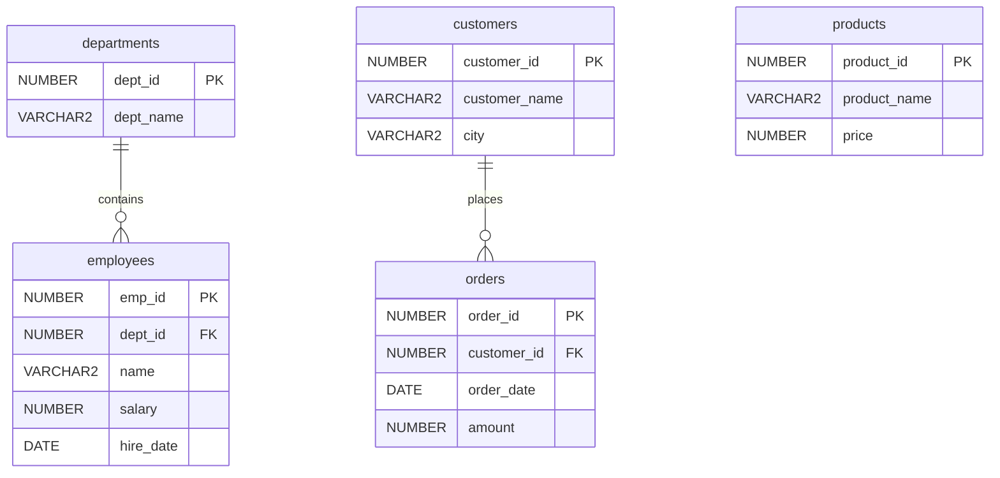

# SQL Learning Journey

**Start with rows. Build summaries. Connect the data.**


A hands-on SQL learning repository built around a small business-style practice dataset. Progress from retrieving and filtering rows to grouping results and joining related tables, with topic notes, practice queries and interview revision material.

[Quick start](#quick-start) · [Lesson map](#lesson-map) · [Dataset](#explore-the-dataset) · [First query](#try-your-first-analysis) · [Revision](#interview-revision)

## Lesson map

| Lesson | What you will explore | Read | Practise |
| --- | --- | --- | --- |
| Day 1 · Find the right rows | SELECT, WHERE, AND/OR/NOT, IN, BETWEEN, LIKE, ORDER BY, dates and FETCH/OFFSET | [Topic notes](Day%201/day1_topics.text) | [SQL practice](Day%201/sql_practice_day_1.sql) |
| Day 2 · Summarize the data | COUNT, SUM, AVG, MIN, MAX, GROUP BY, HAVING and aggregation pitfalls | [Topic notes](Day%202/day2_topics.text) | [SQL practice](Day%202/sql_practice_day_2.sql) |
| Day 3 · Connect related tables | INNER, LEFT, RIGHT, FULL OUTER and self joins, unmatched rows and join cardinality | [Topic notes](Day%203/day3_topics.text) | [SQL practice](Day%203/sql_practice_day_3.sql) |

Start with Day 1 if SQL is new to you. For revision, pick the lesson that matches your question and explain the expected result before running its query.

## Quick start

### 1. Get the repository

```bash
git clone https://github.com/devendraghag/sql-learning-journey.git
cd sql-learning-journey
```

### 2. Prepare a practice database

Use an Oracle database and a SQL client that can execute Oracle scripts, such as SQL Developer or SQLcl. The lesson queries use Oracle syntax, including DATE literals and FETCH/OFFSET; the setup uses NUMBER, VARCHAR2, INSERT ALL and PL/SQL. Other database engines require adaptations.

> **Use a dedicated practice schema.** The setup script begins with a block that attempts to drop the existing orders, employees, customers, products and departments tables. Read it before execution; do not run it against tables you need to keep.

### 3. Load the dataset

Open [sql_practice_dataset.sql](setup_files/sql_practice_dataset.sql) in your SQL client and run it as a script in the practice schema. It creates the five tables, inserts sample rows and commits the data. Check the client output for errors before continuing.

Confirm the seed data loaded:

```sql
SELECT COUNT(*) AS employee_count FROM employees;
```

The supplied seed contains **20 employees**. Then open the Day 1 notes and run its practice queries one at a time.

## Explore the dataset

| Table | Seed rows | Example questions |
| --- | ---: | --- |
| departments | 5 | Which departments exist? |
| employees | 20 | Who earns above a threshold? What is the average salary by department? |
| customers | 20 | Which cities do customers come from? |
| orders | 20 | What is the order total per customer? |
| products | 20 | Which products fall within a price range? |

The checked-in setup contains **85 sample rows** in total. These are practice records using business-style entities.



Products is a standalone table in this dataset; the schema does not define an order-items relationship. Employee department and order customer foreign keys are nullable, so child rows are not required to reference a parent when that key is null.

## Try your first analysis

Combine joining and grouping to calculate average salary by department:

```sql
SELECT d.dept_name,
       COUNT(e.emp_id) AS employee_count,
       ROUND(AVG(e.salary), 2) AS average_salary
FROM departments d
LEFT JOIN employees e ON e.dept_id = d.dept_id
GROUP BY d.dept_id, d.dept_name
ORDER BY average_salary DESC NULLS LAST, d.dept_id;
```

Predict the number of result rows first. With the supplied seed, all five departments appear and IT has the highest average salary. COUNT(e.emp_id) counts matched employees; a department without employees would still appear with a count of zero.

**Next challenge:** show only departments whose average salary exceeds 45,000. Decide whether that condition belongs in WHERE or HAVING before writing it.

## A practical study routine

1. Read the lesson notes and identify the question the query answers.
2. Predict which rows or groups should appear.
3. Run the query against the practice dataset.
4. Change one condition and explain how the result changes.
5. Write a variation without copying the original query.

The current seed gives every customer one order and every department employees. To explore unmatched rows or one-to-many joins, use your own disposable variations of the dataset; those cases are not all represented by the original seed.

## Interview revision

| Question | What to explain |
| --- | --- |
| WHERE or HAVING? | Filtering individual rows versus filtering groups |
| COUNT(*) or COUNT(column)? | Counting rows versus non-null values |
| Why did a join return more rows? | Match cardinality and repeated parent values |
| Why did a LEFT JOIN lose unmatched rows? | How a WHERE predicate treats null-extended rows |
| Which rows belong in the first page? | Explicit ordering and a tie-breaker for deterministic pagination |

## Repository structure

```text
sql-learning-journey/
├── Day 1/        # Retrieval, filtering and sorting
├── Day 2/        # Aggregation and grouping
├── Day 3/        # Joins and related-table queries
├── setup_files/  # Oracle-compatible schema and seed data
├── LICENSE
└── README.md
```

Each day pairs a `.text` topic guide with a `.sql` practice file. There is no application build step; execute the SQL through your database client.

## Scope

The current learning path covers three lessons on retrieval, aggregation and joins. It is a focused foundation for SQL practice and interview revision, rather than a complete SQL curriculum or a claim of compatibility with every database engine.

## License

See [LICENSE](LICENSE) for the repository license terms.
